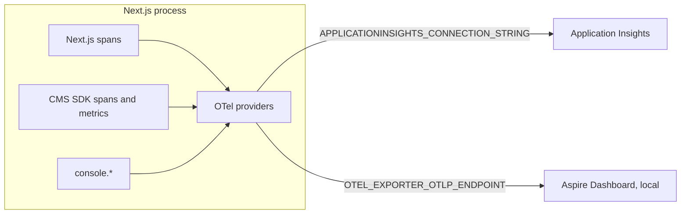

# Observability

The site sends OpenTelemetry traces, metrics and logs to **Application
Insights** on Frontend Hosting, and to a local **Aspire Dashboard** in
development. You get Next.js's own spans (requests, rendering, `fetch`), the
Content JS SDK's spans and metrics (Graph requests, content fetches, component
rendering), and every server-side `console` call, all linked to the request
that produced them.

It's also where Cache Components bites hardest: anything that records
telemetry while a page is prerendering must not read the clock. Getting that
wrong doesn't show up in `next dev` or `next build`, only as 500s on every page
in production.

## How it's wired



- [`src/instrumentation.ts`](../src/instrumentation.ts) `register()` loads
  [`src/instrumentation.node.ts`](../src/instrumentation.node.ts) on the Node
  runtime, but only when there's somewhere to send the data.
- **On Frontend Hosting** the platform sets `APPLICATIONINSIGHTS_CONNECTION_STRING`,
  and the Azure Monitor exporters (`@azure/monitor-opentelemetry-exporter`)
  send to Application Insights.
  - Server spans become **requests**, client spans (Graph calls) become
    **dependencies**, and console output becomes **traces**.
  - `service.name` (`nextjs-fe-hosting`) is the cloud role name.
    `WEBSITE_INSTANCE_ID` is the role instance, so you can tell replicas
    apart. `OPTIMIZELY_ENVIRONMENT` is attached as the deployment environment.
- **Locally** you set `OTEL_EXPORTER_OTLP_ENDPOINT` and the data goes over
  OTLP/HTTP. With neither variable set, telemetry is off and costs nothing.

We use the Azure exporters, not Azure's `useAzureMonitor()` distro. The
distro registers its own metrics provider, which would bypass the
component-metric filter described below.

## Running it locally

Start the Aspire Dashboard in Docker:

```bash
docker run --rm -it -p 18888:18888 -p 4318:18890 \
  -e ASPIRE_DASHBOARD_UNSECURED_ALLOW_ANONYMOUS=true \
  mcr.microsoft.com/dotnet/aspire-dashboard:latest
```

Then set `OTEL_EXPORTER_OTLP_ENDPOINT=http://localhost:4318` in `.env` and
open <http://localhost:18888>. 18890 is the container's OTLP/HTTP port; the
endpoint is the host port you mapped it to.

The [Aspire CLI](https://aspire.dev) can query a running dashboard from the
terminal, which is handy for scripted checks:

```bash
aspire otel traces --dashboard-url http://localhost:18888
aspire otel spans  --dashboard-url http://localhost:18888 --has-error true
aspire otel logs nextjs-fe-hosting --dashboard-url http://localhost:18888
```

You don't need telemetry for everyday local work. Use it when you change the
telemetry setup itself, or upgrade Next.js, the CMS SDK or the OpenTelemetry
packages. Then test a **production build** (`npm run build`, `npm start`),
request a few CMS pages, and check that they return 200 and the data arrives.
`next dev` only logs a warning for the problems described below.

## Querying Application Insights

Ad-hoc queries run in the Azure portal (**Logs**). For scripted access, the
Application Insights query API takes the same KQL. Authenticate as an Entra
app registration (service principal) with the **Reader** or **Monitoring
Reader** role on the resource: get a token with the client-credentials flow
and the scope `https://api.applicationinsights.io/.default`, then POST
`{"query": "..."}` to `https://api.applicationinsights.io/v1/apps/{appId}/query`.

Queries we've found useful:

```kusto
// Failed or slow page requests
requests
| where cloud_RoleName == "nextjs-fe-hosting" and (success == false or duration > 10000)
| project timestamp, name, resultCode, duration, cloud_RoleInstance, operation_Id

// Errors and warnings from console output
traces
| where cloud_RoleName == "nextjs-fe-hosting" and severityLevel >= 2
| summarize n = count(), t0 = min(timestamp), t1 = max(timestamp) by msg = substring(message, 0, 160)

// Slow Graph calls
dependencies
| where type == "HTTP" and target has "cg.optimizely.com" and duration > 5000
| project timestamp, duration, resultCode, operation_Id
```

`first` and `last` are reserved words in KQL. Don't use them as column names.

## Cache Components: never read the clock while prerendering

Under `cacheComponents`, Next.js rejects `Date.now()` while it prerenders a
page's static shell, outside `'use cache'`. In `next dev` that's a logged
error ("encountered the unstable value `Date.now()`"). In production the
prerender fails and **the page returns 500**. `next build` passes here, because
CMS pages aren't prerendered at build time.

The OpenTelemetry SDK reads `Date.now()` whenever it starts a span, records a
metric or emits a log record. Next.js handles spans itself: it runs span
creation outside the prerender scope. It does nothing for metrics or logs, and
both happen during render in this app:

| Telemetry | Recorded during render? | How it's handled |
|---|---|---|
| Spans (Next.js and CMS SDK) | Yes | Fine: Next.js starts spans outside the prerender scope |
| CMS SDK component metrics (`optimizely.component.*`) | Yes, on every component lookup | Turned off: the SDK's meter returns no-op instruments for these two |
| Other CMS SDK metrics (Graph requests, fetches, query generation) | No, they run inside `'use cache'` | Kept |
| `console.*` forwarded as logs | Yes, whenever a component logs | Emitted from the async context captured at startup, which is outside any render. The active span is passed along explicitly, so each log is still linked to its request |

The component spans carry the same timing as the dropped metrics, so nothing
useful is lost. We've reported the metrics problem to the SDK team.

## Fetch timeout

[`src/lib/fetch-timeout.ts`](../src/lib/fetch-timeout.ts) gives Node's
built-in `fetch` a global undici dispatcher that fails any request after
**10 s** without a response. It covers Graph, the webhook registration and the
CDN purge.

Without it, a request that never gets a response waits for undici's default of
300 s. On 2026-10-14 that took Test2 down for five minutes (see
[updates](updates.md)). The CMS SDK makes one schema lookup per process and
shares it with every request. That one call hung, every uncached render waited
on it, and Next.js gave up filling `'use cache'` after about 54 s.

Together with the timeout, `getPageContent` and `getPerson` now cache a
failed lookup for seconds instead of indefinitely. Before, one timed-out call
would have served a 404 until that page's next publish.

## Diagnostics

`/diagnostics/env` lists the variables the running instance has, including
`APPLICATIONINSIGHTS_CONNECTION_STRING` (masked) and, by name only, every
other variable the platform injects. See the README's
[developer tools](../README.md#developer-tools).
